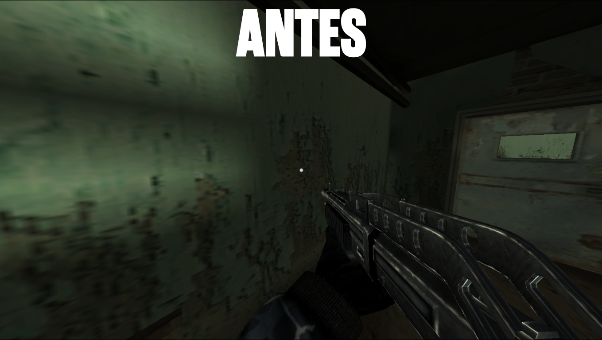
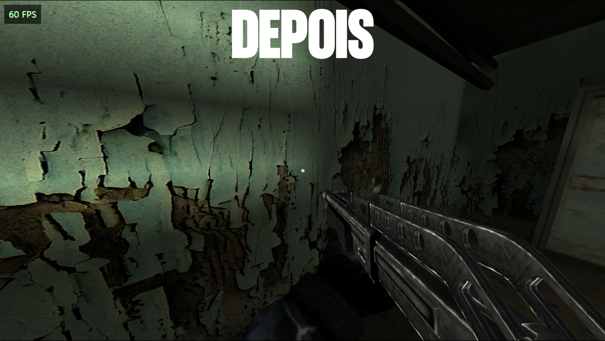
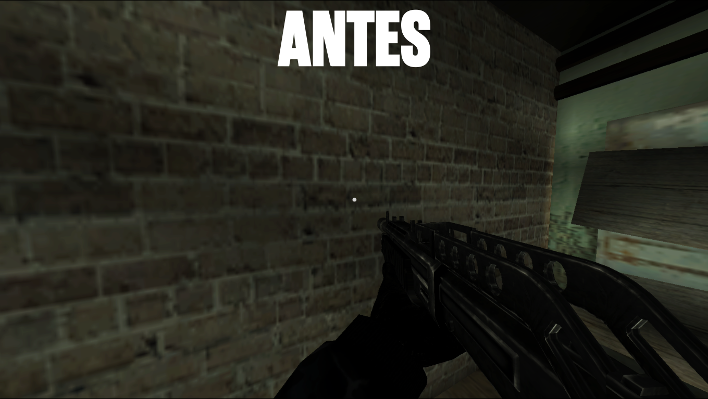
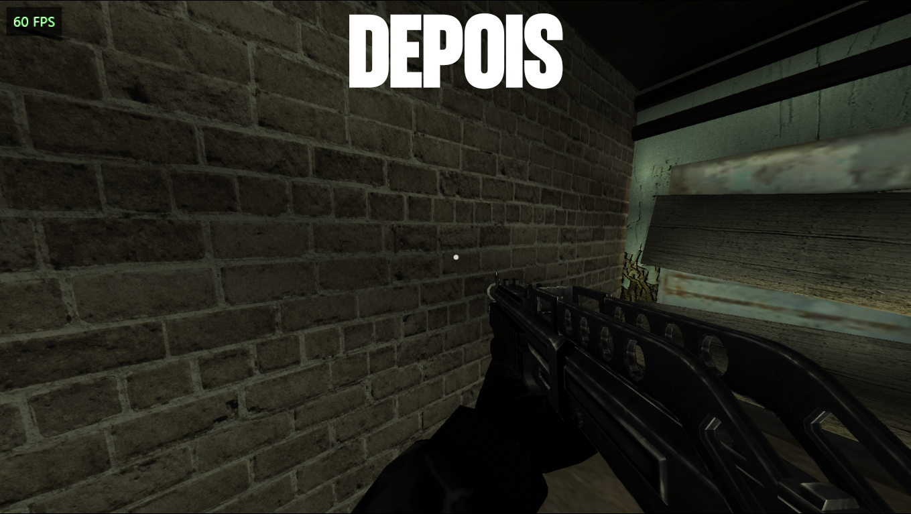

# BLACK PC — Modloader

**Modloader 1.0** para o **[BLACK PC port](https://github.com/Spark198rus/black-pc)** (de **Spark198rus**), o port que roda o `default.xbe` original do **BLACK** (Xbox) nativamente no Windows.

Este repositório é o **código-fonte do modloader** (aberto, GPL-2.0-or-later). Os **mods** que acompanham o pacote
(texturas HD, HUD, PT-BR, ícones…) e ficam no **[Releases](../../releases)** junto com o modloader
pronto para instalar: é só extrair na pasta do port.

---

## ⚠️ Compatibilidade — leia antes de instalar

| | |
|---|---|
| ✅ **Funciona** | **BLACK PC port** do **Spark198rus** — https://github.com/Spark198rus/black-pc |
| ❌ **Não funciona** | **BLACK-XBERecomp** do **TGP482** — https://github.com/TGP482/BLACK-XBERecomp |
| 🎯 **Versão do port** | **Modloader 1.0** funciona no **BLACK PC port 0.2.0** |
| 🎮 **Jogo** | O modloader **não inclui o jogo**: você precisa ter o BLACK (Xbox NTSC-U) já com **dump** dentro da pasta **`game`** do port |

O modloader é um `blackrt.dll` modificado: ele substitui o DLL do port do Spark198rus. O **BLACK-XBERecomp** do TGP482 é
outro projeto (recompilação estática, sem `blackrt.dll`) e **não** tem nenhuma relação com este modloader — não tente
misturar os arquivos dos dois.

---

## O que é o modloader

O port do Spark198rus tinha as opções do PC embutidas (`PC SETTINGS` no menu e na pausa). O modloader acrescenta a
**camada de mods** em cima disso:

- uma pasta **`mods\`** na raiz do port: cada mod é uma pasta dentro dela, e os arquivos dele substituem os do jogo
  **sem alterar o jogo** (o port serve o arquivo do mod na hora da leitura);
- a tela **`PC SETTINGS > MODS`**, no menu principal e na pausa, que liga e desliga cada mod (e as opções do próprio
  modloader, como o HUD 16:9, o HUD que some e as texturas HD);
- **mouse** nos menus (do port e do próprio jogo): o cursor não anda como seta — a linha em que ele está recebe o
  destaque, o **botão esquerdo** confirma (e, em barras, sobe/desce conforme o lado clicado) e o **botão direito** volta;
  a **roda do mouse** anda como as setas cima/baixo;
- **contador de FPS**, aviso de **"Pular video"** nos filmes (com fade), **texturas HD**, legendas `.srt` e as melhorias
  do port (campo de visão, resolução interna, HUD 16:9, brilho, gama, reverb, mouse look…).

Tudo isso é o que está neste repositório. Os **mods em si** (os arquivos de textura, texto e vídeo) **não** estão aqui.

---

## Requisitos

| | |
|---|---|
| **Sistema** | Windows 10 **32 ou 64 bits** |
| **Memória** | 4 GB de RAM |
| **Placa de vídeo** | 1 GB de VRAM (com Direct3D 9) |
| **Armazenamento** | 5 GB livres |
| **Port** | BLACK PC port do Spark198rus (0.2.0) |
| **Jogo** | BLACK (Xbox NTSC-U) com dump em **`game\`** |

Roda em PCs modestos: o port foi feito para levar o jogo do Xbox ao PC sem exigir hardware atual, e o modloader não
acrescenta custo de desempenho (ele é o próprio port, com a camada de mods).

---

## Download e instalação

1. **Baixe o port** (se ainda não tiver): https://github.com/Spark198rus/black-pc
   Deixe o **jogo com dump dentro da pasta `game`**, ao lado do `black.exe`:
   ```
   BLACK\            (a pasta do port)
     black.exe
     blackrt.dll
     game\           -> default.xbe + arquivos do jogo (o dump)
     savedata\
     ...
   ```
2. **Baixe o zip do modloader** na aba **[Releases](../../releases)** (`BLACK-PC-Modloader-1.0.zip`). Ele já contém o
   modloader **e todos os mods**.
3. **Feche o jogo.** Extraia o zip **dentro da pasta do port** (a que tem o `black.exe`), confirmando a substituição do
   `blackrt.dll`.
4. **Abra o `black.exe`.** Os mods já vêm ligados. Para ligar/desligar qualquer um:
   **`OPÇÕES > CONF. PC > MODS`** no menu principal, ou **`pausa (Esc) > CONF. PC > MODS`** durante o jogo.

> Guarde uma cópia do seu `blackrt.dll` antigo antes (ex.: `blackrt.dll.antes`). O pacote também traz o
> `uninstaller-modloader.exe`: dois cliques nele e ele apaga a pasta `mods` e volta o DLL anterior
> (`blackrt.dll.antes-do-modloader` ou `blackrt.dll.original-do-port`). Suas partidas (`savedata`) e o `black.ini`
> **não** são tocados.

### O que já vem no pacote

| Mod / opção | O que faz |
|---|---|
| **HD TEXTURES** | Usa o pack de texturas HD em `mods\hdtextures\hd` (a linha mostra a porcentagem pronta: **`ON 34%`**) |
| **HUD 16:9** | Barras de vida e munição proporcionais, encaixadas nos cantos, sem o esticamento do 4:3 |
| **FADING HUD** | Some com fade quando o jogador fica um tempo sem ação (só os painéis de vida/munição) |
| **PT-BR TEXT + KEYBOARD** | Tradução PT-BR + textos com as teclas do teclado + vídeos legendados |
| **XBOX ICONS AS KEYS** | Ícones A/B/seta dos menus viram teclas do PC (Enter/Bksp/seta) |
| **KEYBOARD PROMPTS (EN)** | Botões do Xbox viram teclas do teclado, em inglês (só vale com o jogo em inglês) |

Os três últimos são pastas dentro de `mods\`. O **HD TEXTURES**, o **HUD 16:9** e o **FADING HUD** são opções do
próprio modloader (aparecem na mesma tela `MODS`).

### Padrões na primeira instalação

Na primeira vez que o modloader abre (sem `black.ini` na pasta do port), ele já vem configurado com:

- **Pular vídeos** ligado;
- **HUD 16:9** ligado;
- **FADING HUD** ligado;
- **HD TEXTURES** ligado (quando o pack está em `mods\hdtextures\hd`);
- **XBOX ICONS AS KEYS** ligado;
- **PT-BR TEXT + KEYBOARD** ligado (o jogo em português);
- **Velocidade de andar** em **25%**;
- **Campo de visão** em **120**;
- **Campo de visão da arma (viewmodel)** em **92**.

A partir da primeira vez que você mudar qualquer opção, o `black.ini` guarda as **suas** escolhas — desligar um mod
continua desligado nas próximas vezes.

---

## Texturas HD

O mod de texturas HD troca, na hora de subir para a placa, as texturas do jogo pelas do pack **BLACK HD Reimagined**
(feito para o BLACK de PlayStation 2). 

Na linha **HD TEXTURES**, depois do **ON**, aparece o quanto do pack está pronto:

> **`HD TEXTURES    ON 34%`**

### Antes e depois

| Antes | Depois |
|:---:|:---:|
|  |  |
|  |  |

---

## Mouse nos menus

Enquanto um menu está na tela, o cursor fica solto e o próprio modloader desenha a seta (a do Windows não aparece):

- **passar o mouse** sobre uma linha coloca o destaque nela (fora das linhas, o destaque fica onde o teclado deixou);
- **botão esquerdo** confirma a linha — e, em barras e listas, sobe/desce conforme o lado em que você clicou (na barra de
  uma opção, o valor acompanha o ponto clicado);
- **botão direito** volta;
- **roda do mouse** anda como as setas cima/baixo;
- teclado e controle continuam funcionando normalmente.

Funciona nos menus do port **e** nos menus do próprio jogo (opções, dificuldade, perfil, teclado de nome, pause…).

---

## Como fazer mods

Qualquer pessoa pode criar mods para o port **sem recompilar nada**: um mod é uma pasta em `mods\` com os arquivos que
ele quer substituir. O port entrega o arquivo do mod no lugar do arquivo do jogo, e o mod liga/desliga na tela `MODS`
sem tocar no jogo.

```
BLACK\
  mods\
    meu-mod\
      mod.ini                 (opcional: nome, prioridade, idioma)
      game\
        language\strings\MainUS.bin     <- substitui o arquivo do jogo
        export\frontend\Core.bin
        videos\...
      subtitles\              (opcional: legendas .srt desenhadas pelo port)
        02_n.srt
```

- **`mod.ini`** — `name = <nome mostrado na tela MODS>`, `priority = <número>` (quem tem a maior prioridade ganha
  quando dois mods trazem o mesmo arquivo) e `lang = <idioma>` (ex.: `en`, `ptbr`; um mod de idioma diferente do que está
  sendo jogado fica bloqueado e não entrega arquivo nenhum).
- **`.off`** — um arquivo chamado `.off` dentro da pasta do mod o deixa **desligado**; sem ele, o mod vem **ligado**. A
  própria tela `MODS` cria/apaga esse arquivo.
- **Reiniciar** — o jogo lê alguns arquivos (textos, por exemplo) apenas ao iniciar. Ao ligar/desligar um mod de
  arquivo, a tela mostra `(REINICIAR)` e o port **se reinicia sozinho** quando você volta ao menu principal.
- **`subtitles\`** — arquivos `.srt` com o nome do filme (`02_n.srt` para `02_n.xmv`), desenhados pelo port por cima do
  vídeo. Ligam/desligam junto com o mod.

O formato completo, com todos os detalhes e exemplos, está em **[docs/MODS.md](docs/MODS.md)**.

---

## Compilando o modloader (código-fonte)

O modloader é o port do Spark198rus + a camada de mods, em **C++20** para **Windows x86 (32 bits)**, com
**Visual Studio / MSVC** e **CMake**. O código está neste repositório:

```
src\            código do modloader (mods, menus, HLE do port, D3D, áudio, input)
stub\           black.exe (stub mínimo que carrega o XBE)
CMakeLists.txt  projeto (gera black.exe + blackrt.dll)
```

```bat
cmake --preset win32
cmake --build build/win32 --config RelWithDebInfo
```

Saída: `build\win32\RelWithDebInfo\black.exe` + `blackrt.dll` (ficam juntos, na pasta do port).
Instruções detalhadas, opções de linha de comando e o mapa dos arquivos: **[docs/BUILDING.md](docs/BUILDING.md)**.

> O modloader é software livre sob **GPL-2.0-or-later** (a mesma licença do port do Spark198rus). Se você distribuir uma
> versão modificada, distribua também o código-fonte.

---

## Créditos

**Modloader, mods e adaptação para PC — [Darketz](https://www.youtube.com/c/Darketz)**
- a camada de mods, a tela `MODS`, o mouse nos menus, o contador de FPS, o aviso "Pular video", o HUD 16:9, o HUD que
  some, o suporte a texturas HD, as legendas e o pacote PT-BR da versão PC.

**Port original (BLACK PC) — Spark198rus**
- https://github.com/Spark198rus/black-pc — o port que roda o `default.xbe` do Xbox nativamente no Windows, sobre o qual
  o modloader é feito.

**Tradução PT-BR original — Bruno Fernando, Rayne Games, André Romhacker e HNNEWGAMES (2018/2019)**
- o texto em português e os vídeos legendados partiram da tradução da comunidade; as modificações e a adaptação para a
  versão PC (textos, menus, botões, título) são do Darketz.

**Pack de texturas HD — "BLACK HD Reimagined"**
- pack de texturas HD do BLACK para PCSX2 (SLUS-21376), usado com o casamento por conteúdo do port.

**Ferramentas**
- Desenvolvido com **IA (Claude Code)** como assistente, **Visual Studio 2026** (MSVC, C++20, CMake) e as seguintes
  linguagens/fontes: **C++20** no loader (HLE do kernel/D3D/áudio/input do Xbox, front end, mods), **ActionScript 2**
  (as páginas do front end do jogo, montadas pelo loader) e **Python** nas ferramentas de apoio (casamento das texturas,
  patch dos textos, empacotamento).
- O port se apoia no Xbox Development Kit (XBE, D3D8, XAPILIB, DSOUND) e no trabalho de engenharia reversa do port
  original do Spark198rus.

**BLACK** é marca registrada da **Electronic Arts**. Este projeto não inclui o jogo nem arquivos do jogo (o dump é
necessário e de responsabilidade de quem instala), nem o port do Spark198rus.

---

## Acompanhe o projeto

- ▶️ **YouTube:** https://www.youtube.com/c/Darketz
- 💬 **Discord:** https://discord.gg/HKpgA9ghVE
- 🐛 **Problemas/sugestões:** abra uma *issue* neste repositório (se for sobre um mod, diga qual e anexe o `black.log`)
- ⬇️ **Downloads:** [Releases](../../releases) — o ZIP do modloader com os mods
- 🎮 **Port:** https://github.com/Spark198rus/black-pc
